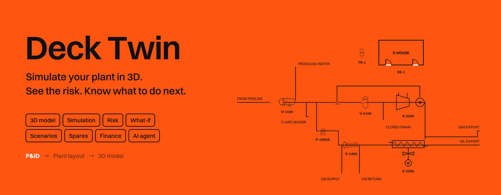

# Deck Twin

Deck Twin is an engine for simulating an oil and gas plant in 3D. It gives you one live view of production, risk, money, maintenance and spares. You can break things on purpose, see how the plant reacts, and get guidance on what to do next.

**Site:** https://decktwin.com

## The problem

- Plant data sits in separate systems, so nobody sees the whole picture.
- When an alarm goes off, the operator has seconds to work out what it means and what to do.
- Procedures live in documents, not at the console.
- Training on real failures is not possible on a running plant.
- A spare that is not offshore can turn a small fault into days of lost production.

## Who it is for

| Who | What they get |
|---|---|
| Control room operators | Ordered steps during an alarm, with the reason for each |
| Shift supervisors and trainers | Realistic failure drills with a score and a debrief |
| Maintenance planners | Work orders, machine health and spares in one place |
| HSE teams | Fire and gas, PPE, hazardous areas and barrier health |
| Asset managers | Risk and lost production in dollars |
| Engineering teams | A 3D plant built from P&IDs and datasheets |

## Features

**See the plant**
- Five-platform offshore field in 3D, generated from data
- Walk through it, look inside with X-ray and section views, and watch the flow
- Enter the control room and use the full console
- Guided tours and a knowledge card for each piece of equipment

**Run the plant**
- Live process simulation: pressure, level, flow, power and utilities
- Alarms and a full shutdown hierarchy, from unit shutdown to abandon platform
- Fire and gas detection, with voting and coverage maps

**Test the plant**
- Create a failure in any part of the plant from the Instructor page: a fire, a gas leak, a machine trip, a stuck valve, or a loss of air or cooling
- Watch the plant react, and see which alarms and shutdowns follow
- 12 scored training scenarios, each with a debrief
- What-if: see the predicted chain of events before you run a scenario

**Manage the plant**
- Production, deferment, revenue, operating cost and carbon
- Work orders, permits and isolation plans
- Spares stock, purchase orders, and supply vessel and helicopter runs
- Inspections by simulated drone and robot, with corrosion tracking

**Build your own plant**
- 220 standards-based 3D components, with a CLI and an agent skill
- An agent turns your documents into a `plant.json`
- Upload it to view and walk your plant. The full console runs on the bundled Alpha field for now

## Where AI is used

Every model call needs a click and your own key. Nothing runs in the background, and the running cost stays on screen.

### Incident guidance

When an alarm or incident comes up, the Response page shows what to do next and why.

1. It reads what an operator can see: alarms, fire and gas zones, shutdowns and machine health.
2. A free plan appears straight away, built from the cause and effect matrix and the RCM library.
3. **Ask Muse Spark** sends that evidence to the model, which returns ordered steps with a reason for each.
4. Every step is checked against the plant and must cite real data.
5. The operator approves. A button such as "Shut down K-2200 here" asks "Are you sure?" first.
6. The twin reads the plant back to confirm it happened, then you can re-plan around anything that failed.

The RCM library holds example failure modes for each machine type. You can edit them as a demo, and the plans change straight away.

### Build a scenario with AI

Describe a drill in plain words, for example "a stuck ESD valve during a fire in the compression area". The model writes it as data, never code. Every tag is checked, the drill runs once with nobody at the console, and any failures go back to the model. It then joins the scenario library and is scored like the others.

### Camera analysis

SAM 3.1 finds people and hazards on the colour CCTV cameras. It stays off until you switch it on. Until then, detections are simulated, and each camera says which it is.

- **Typed prompts.** While real SAM 3.1 is on, type up to three short phrases, such as "ladder", for it to mask as well. They are masks only: no alarm and no log entry.
- **Review the last 10 s.** One press sends a short clip of the main monitor on your own Meta key and replays it with tracked masks. Nothing is recorded until the switch is on.

### Agents, Investigate and Ask the plant

These use the same Muse Spark connection as the Response and Scenarios pages. Read-only tools gather the evidence from the plant, and one click makes one request. With no key saved, or if a call fails, a local planner answers and the panel says so. The key field is in the Agents panel.

### Models

| Provider | Model | You need |
|---|---|---|
| Modal | Muse Spark Open (`meta-models/Muse-Spark-Open-816B-A42B`) | Your endpoint URL and a proxy token |
| Baseten | Muse Spark Open (`meta-models/muse-spark-open-1026`) | An API key |
| Meta Model API | Muse Spark or Muse Wonder, chosen from a list | An API key |
| Modal or Meta Model API | SAM 3.1, for cameras | See `modal/README.md` |

Open the console, go to Response or Scenarios, or open the Agents panel, pick a provider and save your key. One key serves the whole console.

These model paths are tested with a stubbed model. The real Meta Model API path has not been run with a live key yet.

## How risk is classified

**In the twin.** Each platform gets a live score from 0 to 100, and every point traces to a named cause, such as "HP separator level 79 % +18".

| Input | Examples |
|---|---|
| Process | Separator level and pressure, surge margin, instrument air, flaring |
| Fire and gas | Gas and flame detections, deluge |
| Shutdowns | Weighted by level, from unit shutdown to abandon platform |
| Alarms | Weighted by priority, plus alarm floods |
| Machinery | Degrading, failed or tripped machines |
| Barriers | Inhibited detectors, stuck valves, severe corrosion |

| Score | Band |
|---|---|
| Under 25 | Low |
| 25 to 49 | Moderate |
| 50 to 74 | High |
| 75 and over | Critical |

**In the data engine.** Each sensor gets a severity from its operating limits. Equipment risk combines those severities with the machine's age and criticality, and uses the same four score bands. A tripped machine counts as at least 90.

## How HSE is tracked

| Area | What the twin watches |
|---|---|
| Fire and gas | 181 detectors in 32 zones, with low, high and confirmed states |
| People | PPE on camera, workers near moving machinery, workers in hazardous areas |
| Hazardous areas | Zone 0, 1 and 2 overlays |
| Work control | Permits, lock-outs and isolation plans |
| Hidden risk | Barrier erosion, such as detectors out of service, and sensors drifting towards a trip |

Each of these raises an alert with a full trace of how it was reached. Alerts are drafted to an outbox and not sent. All of this runs on simulated data.

## Accounts and views

The console opens as a signed-in user, shown at the top right, with four views: System admin, Operator, Finance and HSE. Each view shows the tabs that role needs.

There is no sign-in page yet, so everyone is the default system admin, and hiding a tab is a display choice, not a lock. The [`database`](database) folder holds the Cloudflare D1 schema, seed and init script for accounts, sessions, views and a log of paid model calls. The database is not bound yet.

## The data engine

The twin runs on its own simulator, so every reading in this demo is simulated. For a real plant, a separate data engine would feed it live. The engine already exists. It was not built for this hackathon, and its source is not in this repo.

```
Plant systems        Edge gateway        Data engine                              Twin
PLCs, DCS, sensors → on site         →   Ingest → Kafka → Risk engine        →    Gauges, alarms,
historians           buffers and         (HTTPS)          validates, scores        risk, 3D model
                     forwards                             alerts
                                                               ↓
                                                         ClickHouse + Postgres
```

| Piece | Job |
|---|---|
| Edge device or gateway | Collects readings from different areas of the plant and sends them over HTTPS |
| Ingest bridge | Takes readings over HTTPS with an API key, so Kafka is never exposed |
| Kafka | Carries readings, risk scores and alerts between services |
| Risk engine | Validates each reading, scores risk and manages alerts |
| Flink | Runs the same logic as a stream job alongside the risk engine |
| ClickHouse | Data warehouse for readings, risk scores and alerts |
| Postgres | Equipment master data, operating limits and RCM failure modes |
| Airflow | Scheduled batch work around the stream, such as periodic inspection data and reconciliation |

**Bad data is handled.** Malformed readings go to a dead letter queue and are repaired where possible. The engine also spots false alarms: a stuck sensor, a one-off spike, or one signal moving while the rest of the machine stays flat.

**Every alert has a lifecycle:** Raised, Investigating, then Confirmed or False alarm, then Resolved. People sign off the outcome, and that record feeds future analysis.

**How it would reach the twin.** The twin reads every instrument through one seam, `sample()` and `history()` in `alpha/src/ui/live.ts`. Feed that seam and the gauges, trends, alarms, risk and 3D model follow the real plant. This link is not wired yet.

### Monitoring

The engine is monitored with Prometheus and Grafana.

| Layer | What is watched |
|---|---|
| Servers | CPU, memory and disk |
| Containers | Resource use against their limits |
| Kafka | Broker health and consumer lag |
| Flink | Job health, throughput, checkpoints and restarts |
| ClickHouse | Queries, merges, memory and disk |
| Airflow | Scheduler health and task runs |
| Endpoints | Whether ingest and dashboards can be reached |

Alerts fire on targets going down, low memory, disks filling, containers near their limits, a missing Kafka broker and high consumer lag. Grafana has one dashboard for pipeline health and one for plant risk.

## Self-hosting

The engine runs in containers, so it can be hosted in a customer's own cloud account or Kubernetes cluster. Data stays inside their tenant.

The [`self-hosting`](self-hosting) folder shows how the engine is deployed. **It is reference code: refer to it and adjust it for your setup.** It needs the engine's source next to it, and it has not been run from this repo.

| Target | Script | Runs on |
|---|---|---|
| AWS | `self-hosting/aws/deploy.sh` | Docker on EC2, or managed services such as MSK and RDS |
| Azure | `self-hosting/azure/deploy.sh` | Docker on a VM, or managed services such as Event Hubs |
| GCP | `self-hosting/gcp/deploy.sh` | Docker on GCE, managed services, or Pub/Sub, Dataflow and BigQuery |
| Any Linux VM | `self-hosting/any-vm/install.sh` | Docker on a machine you already own |

Each wizard asks for your sizing, prints a full plan with an estimated cost, and creates nothing until you type `deploy`. Every cloud wizard has a `--dry-run` mode.

## Security

- **Deploy in your own tenant.** Plant data of this kind should stay inside the customer's environment.
- **The model never touches the plant.** Agent tools are read-only, and an operator approves every action.
- **Keys stay with the operator.** They are encrypted in the browser, sent only to the chosen provider, and never stored on a server.
- **Nothing is exposed but the TLS proxy.** Kafka, ClickHouse, Flink and Postgres stay on private networks.
- **Secrets are generated, not typed,** and SSH is limited to the installer's IP address.

## What's next

- Connect the data engine to the twin
- Sign-in, and the D1 database bound to the console views
- Share specific action items from one role to another
- Kubernetes manifests for the twin and the engine
- Edge gateway connectors for OPC UA, Modbus and MQTT
- The full console on uploaded plants

## Use the components

The CLI is not on npm yet. Until it is, run it from the registry site:

```bash
npx -y https://deck-twin-library.demoareeb.workers.dev/cli/deck-twin.tgz <command>
```

The examples below use the short `npx deck-twin`, which works once the package is published.

```bash
npx deck-twin add horizontal-separator centrifugal-pump gate-valve
npx deck-twin validate plant.json && npx deck-twin assemble plant.json
npx deck-twin skill
```

| Doc | What it covers |
|---|---|
| [Introduction](docs/introduction.md) | What it is, and what it isn't |
| [CLI](docs/cli.md) | Every command |
| [Assembling plants](docs/assemble.md) | Writing a `plant.json` |
| [Agent skill](docs/agents.md) | Using it from an AI agent |
| [Standards](docs/standards.md) | The dimensional tables |
| [Adding a component](docs/contributing.md) | Writing a new component |
| [Database](database/README.md) | The D1 tables for accounts and views |

## Develop

```bash
npm install && npm run dev                # site, http://localhost:5190
cd alpha && npm install && npm run dev    # twin, http://localhost:5191/alpha/demo/
npm test                                  # in each folder
```

## Honesty

Everything in the twin is simulated, including process values, alarms, stock and prices. It is a demonstration, not a safety system, and it must not be used to operate a real plant. The RCM rows are examples, not a real asset's study. The geometry is generic, not vendor CAD, and the standards tables are reference values.

## License

Free for personal use. Commercial use needs a license. This covers both the components and the engine: see [LICENSE](LICENSE). It is not MIT and not open source.

Visit [decktwin.com](https://decktwin.com) to learn more.
