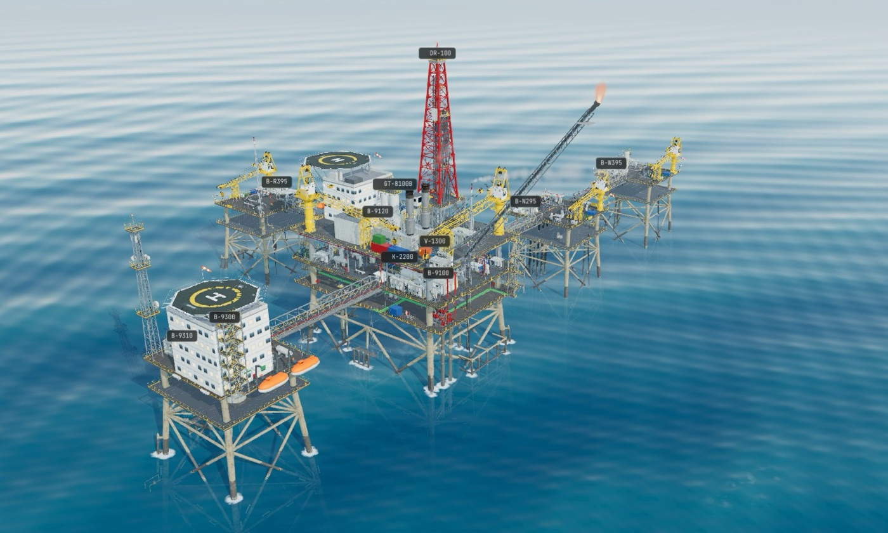
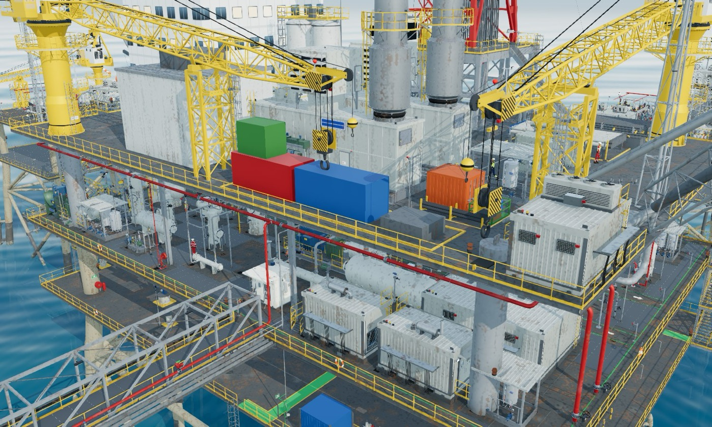
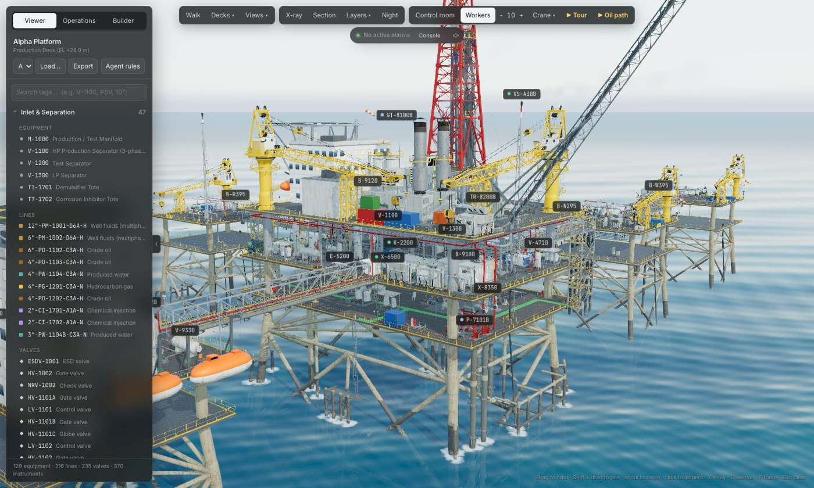
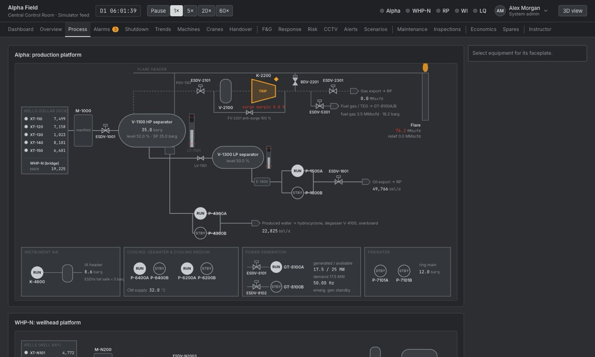
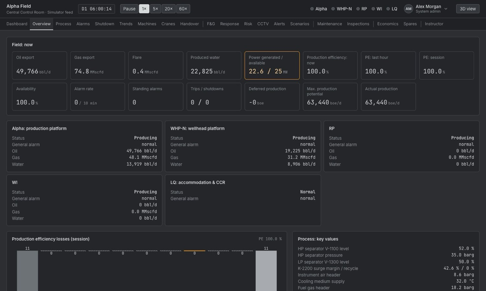
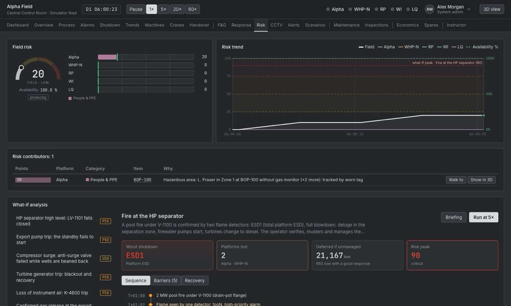
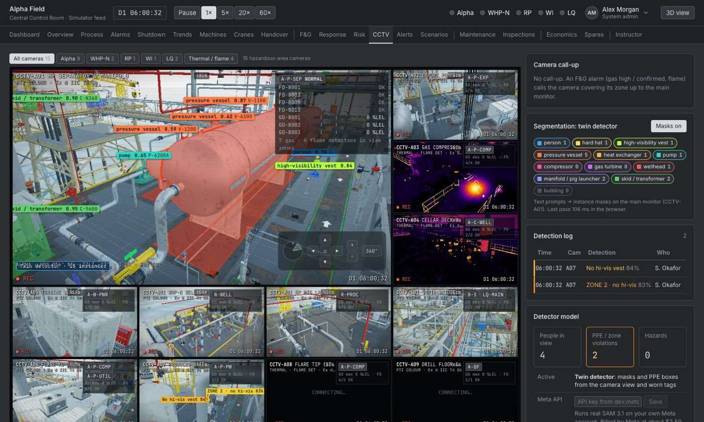
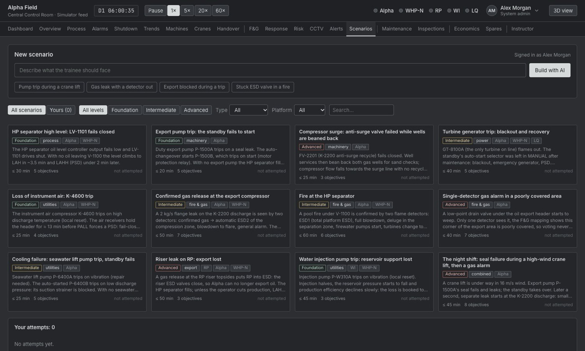
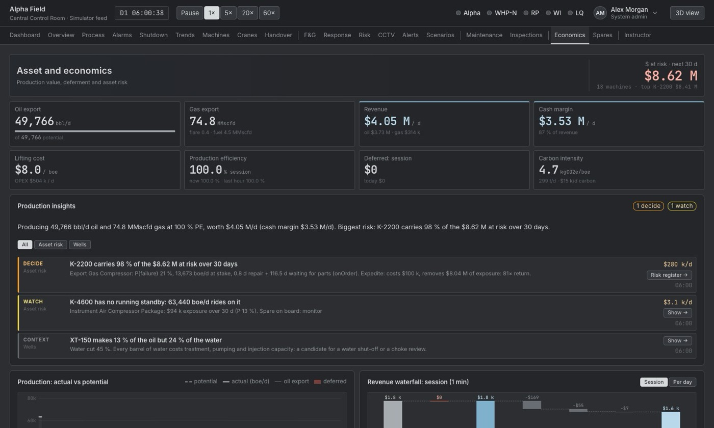

# Deck Twin

Deck Twin is an engine for simulating an oil and gas plant in 3D. It gives you one live view of production, risk, money, maintenance and spares. You can break things on purpose, see how the plant reacts, and get guidance on what to do next.

**Site:** https://decktwin.com · **npm:** [`decktwin`](https://www.npmjs.com/package/decktwin)

**Contents:** [Screenshots](#screenshots) · [Features](#features) · [Example usage](#example-usage) · [Architecture](#architecture) · [AI in Deck Twin](#ai-in-deck-twin) · [Connecting plant data](#connecting-plant-data) · [Data engine](#data-engine) · [Database](#database) · [Deployment](#deployment) · [Security](#security) · [Development](#development)

## Who it is for

| Who | What they get |
|---|---|
| Control room operators | Ordered steps during an alarm, with the reason for each |
| Shift supervisors and trainers | Realistic failure drills with a score and a debrief |
| Maintenance planners | Work orders, machine health and spares in one place |
| HSE teams | Fire and gas, PPE, hazardous areas and barrier health |
| Asset managers | Risk and lost production in dollars |
| Engineering teams | A 3D plant built from P&IDs and datasheets |

## Screenshots

| | |
|---|---|
|  |  |
| **The field.** Five bridge-linked platforms, generated from data. | **The production deck.** Separators, compression, power and cranes, with every line routed. |
|  |  |
| **The viewer.** Search any tag, walk the decks, X-ray and section views. | **Process.** The live flow schematic, here with the export compressor tripped. |
|  |  |
| **Overview.** Field production, power, alarms and production efficiency. | **Risk.** A live score per platform, each point traced to a cause, and what-if. |
|  |  |
| **CCTV.** Colour and thermal cameras, PPE and hazardous-zone checks. | **Scenarios.** Scored drills, or describe a new one and build it with AI. |
|  | |
| **Economics.** Revenue, margin, deferment and the money at risk per machine. | |

## Features

**See the plant**
- A five-platform offshore field in 3D: production, wellhead, riser, water injection and accommodation platforms, linked by bridges
- 129 equipment items, 216 lines, 235 valves and 370 instruments on the Alpha platform, all generated from data
- Walk through it, look inside with X-ray and section views, and follow the oil path
- Day and night, workers on shift, and cranes you can drive from the cab
- A control room with the full console and live screens on the video wall
- Guided tours, and a knowledge card for each piece of equipment

**Run the plant**
- A dynamic process simulation: pressure, level, flow, compression, power, utilities and water injection
- Alarms with priorities, shelving and flood detection
- The full shutdown hierarchy, from unit shutdown to abandon platform, driven by a cause and effect matrix
- Fire and gas: 181 detectors in 32 zones, with voting and coverage maps
- Hazardous area overlays for Zone 0, 1 and 2

**Test the plant**
- Create a failure anywhere from the Instructor page: a fire, a gas leak, a machine trip, a stuck valve, or a loss of air or cooling
- Watch the plant react, and see which alarms and shutdowns follow
- 12 scored training scenarios, each with a debrief
- What-if: the predicted sequence, the barriers and the recovery before you run a scenario

**Manage the plant**
- Production, deferment, revenue, operating cost and carbon
- Work orders, permits, lock-out and isolation plans
- Spares stock, purchase orders, and supply vessel and helicopter runs
- Inspections by drone and robot, with corrosion tracking
- Shift handover

**The console**
- 20 pages, from Dashboard and Process to Economics and Instructor
- Role views for System admin, Operator, Finance and HSE
- Run the clock at 1×, 5×, 20× or 60×

**Build your own plant**
- 220 standards-based 3D components in 16 categories, with a CLI and an agent skill
- An agent turns your P&IDs, datasheets and equipment lists into a `plant.json`
- Load it to view and walk your plant

## Example usage

### Add components to a React Three Fiber project

```bash
npx decktwin add horizontal-separator centrifugal-pump gate-valve
```

```tsx
import { Canvas } from '@react-three/fiber'
import { OrbitControls } from '@react-three/drei'
import { Stage } from './components/deck-twin/lib/stage'
import { HorizontalSeparator } from './components/deck-twin/vessels/horizontal-separator'
import { CentrifugalPump } from './components/deck-twin/rotating/centrifugal-pump'

export default function App() {
  return (
    <div style={{ position: 'fixed', inset: 0 }}>
      <Canvas shadows camera={{ position: [14, 9, 16], fov: 35 }}>
        <Stage radius={10}>
          <HorizontalSeparator tag="V-100" />
          <CentrifugalPump tag="P-101A" position={[6, 0, 5]} rotation-y={Math.PI} />
        </Stage>
        <OrbitControls makeDefault />
      </Canvas>
    </div>
  )
}
```

### Describe a plant and assemble it

`plant.json`:

```json
{
  "name": "HP separation",
  "items": [
    { "tag": "DECK-1", "component": "deck-module", "position": [0, 0, 0], "props": { "length": 30, "width": 20 } },
    { "tag": "V-100", "component": "horizontal-separator", "position": [-6, 0, -3], "props": { "service": "3-phase", "pressure": 40 } },
    { "tag": "P-101A", "component": "centrifugal-pump", "position": [6, 0, 4], "rotation": 180 }
  ],
  "lines": [
    {
      "tag": "6\"-PO-1001-D6A-N",
      "from": "V-100.liquid",
      "to": "P-101A.suction",
      "service": "oil",
      "inline": [{ "component": "gate-valve", "at": 0.25 }, { "component": "y-strainer", "at": 0.75 }]
    }
  ]
}
```

```bash
npx decktwin validate plant.json     # every problem, with a fix for each
npx decktwin assemble plant.json     # installs what the plant uses and writes src/PlantScene.tsx
```

### Let an agent build it from your documents

```bash
npx decktwin skill                   # installs the agent skill into .claude/skills/deck-twin/
```

Then give the agent your P&IDs, datasheets or equipment list and ask for a `plant.json`. It looks up names, props and ports with the CLI and validates the result.

### CLI commands

| Command | What it does |
|---|---|
| `decktwin init` | Writes `deck-twin.json` with the install folder and registry |
| `decktwin add <name…>` | Copies components and the shared `lib/` into your project |
| `decktwin list [category]` | Lists components by category |
| `decktwin search <words>` | Finds components by name, tag, standard or category |
| `decktwin info <name>` | Props with ranges and defaults, ports and standards |
| `decktwin validate <plant.json>` | Reports every problem in a plant and how to fix it |
| `decktwin assemble <plant.json>` | Validates, installs everything the plant uses and writes the scene |
| `decktwin skill` | Installs the agent skill |

| Doc | What it covers |
|---|---|
| [Introduction](docs/introduction.md) | What the library is |
| [Installation](docs/installation.md) | Peer dependencies and setup |
| [CLI](docs/cli.md) | Every command and flag |
| [Assembling plants](docs/assemble.md) | The `plant.json` format |
| [Agent skill](docs/agents.md) | Using it from an AI agent |
| [Standards](docs/standards.md) | The dimensional tables |
| [Adding a component](docs/contributing.md) | Writing a new component |

## Architecture

```
                         ┌───────────────────────── Browser ─────────────────────────┐
plant.json or the  ──►   │ Plant model (equipment, lines, valves, instruments)        │
bundled Alpha field      │   ├─► 3D scene: three.js via React Three Fiber             │
                         │   │     piping, equipment, structure, sea, sky, effects    │
                         │   └─► Simulator (1 s ticks × speed)                        │
                         │         process, power, ESD, fire and gas, KPIs            │
                         │         plugins: maintenance, spares, finance, cranes,     │
                         │         scenarios, inspections                             │
                         │           └─► Safety layer: risk, alerts, CCTV, workers,   │
                         │               hazardous areas, agent tools (read-only)     │
                         │                 └─► Console: 20 pages, role views          │
                         └──────────────────────────┬────────────────────────────────┘
                                                    │ model and camera calls
                         ┌──────────────────────────▼────────────────────────────────┐
                         │ Cloudflare Worker: static site, model routes, session      │
                         │ route, private media (R2), accounts (D1)                   │
                         └──────────────────────────┬────────────────────────────────┘
                                                    ▼
                          Muse Spark (Modal, Baseten, Meta)   SAM 3.1 (Modal GPU, Meta)
```

| Layer | Where | What it does |
|---|---|---|
| Plant model | `alpha/src/model/` | The plant as plain data. The renderer never hard-codes a tag |
| 3D scene | `alpha/src/scene/` | Piping fabrication (spools, elbows, flanges, supports), equipment, decks, environment, batching and adaptive quality |
| Simulator | `alpha/src/state/sim.ts`, `alpha/src/sim/` | The dynamic plant model and its plugins, ticking in simulated seconds |
| Safety layer | `alpha/src/safety/` | Risk scores, alerts, CCTV, workers, hazardous areas, inspections, read-only agent tools |
| Console | `alpha/src/ui/hmi/` | The control-room pages and role views |
| Agents | `alpha/src/agents/` | The model connection, the scenario author and the next-action planner |
| Worker | `alpha/worker.js`, `alpha/*-route.js` | Static assets, model routes, session route, private media |
| SAM 3.1 service | `modal/` | SAM 3.1 on a Modal GPU behind a key check and rate limit |
| Database | `database/` | Schema and seed for accounts, sessions, views and a model call log |
| Component library | `registry/`, `src/`, `cli/`, `skill/` | The 3D components, the website, the CLI and the agent skill |
| Self-hosting | `self-hosting/` | Deployment wizards for the data engine |

**Stack:** React 19, three.js 0.186 through React Three Fiber 9 and drei, zustand 5, Vite 8 and TypeScript 6, served by Cloudflare Workers. The SAM 3.1 service is Python on Modal. The data engine runs on Kafka, Flink, ClickHouse and Postgres.

**The plant is data.** The same renderer draws the Alpha field, an onshore compressor station and any plant compiled from a `plant.json`. Equipment, lines, valves and instruments are generated from the model, so a new plant needs no new 3D code.

### Scale

| Part | Size |
|---|---|
| Twin | About 91 000 lines of TypeScript in 311 files, including plant data and knowledge tables |
| Component registry | 220 components in 16 categories, about 58 000 lines |
| Alpha platform | 129 equipment items, 216 lines, 235 valves, 370 instruments |
| Fire and gas | 181 detectors, 32 zones |
| Safety logic | 20 cause and effect rows, 5 shutdown levels |
| Tests | 153 for the library and CLI, 800 for the twin, plus the SAM service suite |

### How risk is scored

Each platform gets a live score from 0 to 100, and every point traces to a named cause, such as "HP separator level 79 % +18".

| Input | Examples |
|---|---|
| Process | Separator level and pressure, surge margin, instrument air, flaring |
| Fire and gas | Gas and flame detections, deluge |
| Shutdowns | Weighted by level, from unit shutdown to abandon platform |
| Alarms | Weighted by priority, plus alarm floods |
| Machinery | Degrading, failed or tripped machines |
| Barriers | Inhibited detectors, stuck valves, severe corrosion |

Scores under 25 are Low, 25 to 49 Moderate, 50 to 74 High, and 75 and over Critical. In the data engine, each sensor gets a severity from its operating limits, and equipment risk combines those with the machine's age and criticality on the same bands.

### How HSE is tracked

| Area | What the twin watches |
|---|---|
| Fire and gas | 181 detectors in 32 zones, with low, high and confirmed states |
| People | PPE on camera, workers near moving machinery, workers in hazardous areas |
| Hazardous areas | Zone 0, 1 and 2 overlays |
| Work control | Permits, lock-outs and isolation plans |
| Hidden risk | Barrier erosion, such as detectors out of service, and sensors drifting towards a trip |

Each raises an alert with a full trace of how it was reached, drafted to an outbox for review.

## AI in Deck Twin

Every model call needs a click and the operator's own key. The running cost stays on screen.

| Feature | Model | What it does |
|---|---|---|
| Incident guidance | Muse Spark | The Response page turns alarms, fire and gas, shutdowns and machine health into ordered steps, each with a reason and cited plant data. The operator approves every action, and the twin confirms it happened |
| Scenario builder | Muse Spark | Describe a drill in plain words. The model writes it as data, every tag is checked, and the drill is test-run before it joins the library |
| Agents, Investigate, Ask the plant | Muse Spark | Read-only tools gather evidence from the plant, and one click makes one request |
| Camera analysis | SAM 3.1 | Finds people and hazards on the colour CCTV cameras, masks up to three typed phrases, and replays the last 10 s with tracked masks |

| Provider | Model | You need |
|---|---|---|
| Modal | Muse Spark Open (`meta-models/Muse-Spark-Open-816B-A42B`) | Your endpoint URL and a proxy token |
| Baseten | Muse Spark Open (`meta-models/muse-spark-open-1026`) | An API key |
| Meta Model API | Muse Spark or Muse Wonder | An API key |
| Modal or Meta Model API | SAM 3.1 | See [`modal/README.md`](modal/README.md) |

Pick a provider in the Agents panel, or under Model on the Response or Scenarios page, and save your key. One key serves the whole console. Without a key, a local rule planner built from the cause and effect matrix and the RCM library answers instead.

### How a model call works

```
Browser (console)                         Worker route                         Provider
read-only tools gather evidence    →     /alpha/api/llm                 →     Modal, Baseten or
from the plant                            checks body, model and roles          Meta Model API
one click = one request                   key used once, never stored
                                   ←     streams the answer straight back
answer is checked against the plant
operator approves each action
```

- **The key travels in the request body,** not a header, so it never reaches request logs. It is used for that one request and never stored.
- **The provider list is fixed.** The Worker builds the upstream request itself, so the route can't be pointed anywhere else.
- **Limits:** 80 messages and 800 kB per request, 24 000 output tokens per answer, and a session limit in the console.
- **The model never acts on the plant.** Its tools only read, and an operator approves every step.

## Connecting plant data

```
PLCs, DCS, sensors,  →  Edge gateway  →  Ingest (HTTPS,  →  Kafka  →  Risk engine  →  ClickHouse
historians              on site          API key)                    and Flink         and Postgres
                                                                                            │
                                                                     Twin adapter ◄─────────┘
                                                                     maps sensors to twin tags
                                                                            │
                                         ┌──────────────────────────────────┴───────────────┐
                                         ▼                                                  ▼
                              live.ts: sample() and history()                    Simulator state
                              gauges, trends, inspector,                         alarms, shutdowns,
                              control-room screens, agent tools                  risk, 3D effects
```

The twin has two integration points:

- **`sample()` and `history()` in `alpha/src/ui/live.ts`.** Every displayed instrument value and trend goes through these, so a feed here drives the gauges, inspector, knowledge cards, control-room screens and agent tools.
- **The simulator state** in `alpha/src/state/sim.ts`. Alarms, shutdowns, risk and the 3D effects read it, so measured values written here drive those too.

Each reading in the data engine carries `event_id`, `equipment_id`, `sensor`, `value`, `unit`, `running` and `ts`. The adapter maps each `equipment_id` and `sensor` to the twin's instrument tag, such as `PT-1101`.

**To connect a plant:**
1. Install an edge gateway on site that reads the control system (OPC UA, Modbus or MQTT) and forwards readings over HTTPS with the ingest API key.
2. Deploy the data engine in your own cloud or cluster (see [Deployment](#deployment)).
3. Build the plant from your P&IDs into a `plant.json`, so the twin's tags match the real plant.
4. Map engine sensors to those tags in the adapter, and feed both integration points.

## Data engine

The data engine is a separate streaming service that validates readings, scores risk and manages alerts. This repo holds its deployment scripts in [`self-hosting`](self-hosting).

| Piece | Job |
|---|---|
| Edge device or gateway | Collects readings from each area of the plant and sends them over HTTPS |
| Ingest bridge | Takes readings over HTTPS with an API key, so Kafka is never exposed |
| Kafka | Carries readings, risk scores and alerts between services |
| Risk engine | Validates each reading, scores risk and manages alerts |
| Flink | Runs the same logic as a stream job alongside the risk engine |
| ClickHouse | Data warehouse for readings, risk scores and alerts |
| Postgres | Equipment master data, operating limits and RCM failure modes |
| Airflow | Scheduled batch work, such as periodic inspection data and reconciliation |
| Streamlit and Grafana | Dashboards for pipeline health and plant risk |
| Caddy | The TLS front door, and the only service exposed to the internet |

**Kafka topics:** `plant.sensor.readings`, `plant.sensor.dlq`, `plant.sensor.dlq.outcomes`, `plant.risk.scores`, `plant.risk.alerts`, `plant.notifier.control`, `plant.notifier.emails`, `plant.rca.audit`, `plant.sim.control` and `events`. Partition counts follow the expected events per second.

**Bad data is handled.** Malformed readings go to a dead letter queue and are repaired where possible. The engine also spots false alarms: a stuck sensor, a one-off spike, or one signal moving while the rest of the machine stays flat.

**Every alert has a lifecycle:** Raised, Investigating, then Confirmed or False alarm, then Resolved. People sign off the outcome, and that record feeds future analysis.

**Monitoring** runs on Prometheus and Grafana: servers, containers, Kafka broker health and consumer lag, Flink jobs and checkpoints, ClickHouse, Airflow and endpoint reachability. Alerts fire on targets going down, low memory, disks filling, containers near their limits, a missing broker and high consumer lag.

## Database

An initial database setup is included in [`database`](database): a schema, seed data and an init script for Cloudflare D1. It covers organisations, account types, users, sessions, console views and a log of paid model calls. See [`database/README.md`](database/README.md) to set it up.

```bash
./database/init.sh            # local database
./database/init.sh --remote   # the bound D1 database
```

## Deployment

### Site and twin

The site and the twin are static files plus one Cloudflare Worker.

```bash
npm run build:all       # builds the twin, then the site, into dist/
npx wrangler deploy
```

A push to `main` runs the same steps with Workers Builds. The SAM 3.1 service deploys to Modal with `modal deploy sam31.py` from `modal/`.

### Data engine on a cloud or a VM

The engine runs in containers, so it can be hosted in the customer's own cloud account, and plant data stays inside their tenant. The scripts in [`self-hosting`](self-hosting) are reference deployments to adapt to your setup.

| Target | Script | Runs on |
|---|---|---|
| AWS | `self-hosting/aws/deploy.sh` | Docker on EC2, or managed services such as MSK and RDS |
| Azure | `self-hosting/azure/deploy.sh` | Docker on a VM, or managed services such as Event Hubs |
| GCP | `self-hosting/gcp/deploy.sh` | Docker on GCE, managed services, or Pub/Sub, Dataflow and BigQuery |
| Any Linux VM | `self-hosting/any-vm/install.sh` | Docker on a machine you already own |

Each wizard asks for your sizing, prints a full plan with an estimated cost, and creates nothing until you type `deploy`. Every cloud wizard has a `--dry-run` mode.

### Kubernetes

For a customer's own cluster, the pieces map onto Kubernetes like this:

| Piece | Kubernetes object | Common options |
|---|---|---|
| Kafka | StatefulSet, or an operator | Strimzi, or a managed Kafka |
| ClickHouse | StatefulSet with persistent volumes | The Altinity ClickHouse operator, or ClickHouse Cloud |
| Postgres | StatefulSet, or an operator | CloudNativePG, or a managed Postgres |
| Flink | Flink jobs | The Flink Kubernetes Operator |
| Ingest bridge, risk engine, consumers | Deployments with autoscaling | |
| Airflow | Deployment | The official Airflow Helm chart |
| Dashboards | Deployments | Grafana and Streamlit |
| Twin and site | A Deployment serving the static build | Any web server behind the ingress |
| Model and session routes | A small Node service | The routes from `alpha/worker.js` |
| Monitoring | Prometheus and Grafana | kube-prometheus-stack |
| TLS | Ingress controller | cert-manager for certificates |

- On Kubernetes, the Worker's routes (`/alpha/api/llm`, the SAM routes and the session route) run as a small Node service, with object storage and Postgres in place of R2 and D1.
- Only the ingress is public. Kafka, ClickHouse, Flink and Postgres stay on the cluster network, with network policies between them.
- Secrets live in Kubernetes Secrets or the cloud's secret manager, and are generated rather than typed.

## Security

- **Deploy in your own tenant.** Plant data stays inside the customer's environment.
- **The model never touches the plant.** Agent tools are read-only, and an operator approves every action.
- **Keys stay with the operator.** They are encrypted in the browser, sent only to the chosen provider, and never stored on a server.
- **Paid calls are opt-in.** Every model feature starts off on each page load and runs only after a click, with the cost on screen and a hard limit.
- **Nothing is exposed but the TLS proxy.** Kafka, ClickHouse, Flink and Postgres stay on private networks.
- **Secrets are generated, not typed,** and SSH is limited to the installer's IP address.

## Development

```bash
npm install && npm run dev                # site, http://localhost:5190
cd alpha && npm install && npm run dev    # twin, http://localhost:5191/alpha/demo/
```

| Folder | Tests |
|---|---|
| `.` | `npm test`: the registry, the CLI and `plant.json` validation |
| `alpha/` | `npm test`: the simulator, safety logic, agents, routes and console views |
| `modal/` | `uv run --no-project pytest -m "not live"`: the SAM 3.1 service |

GitHub Actions runs all three on every push.

## Disclaimer

The bundled Alpha field runs on a built-in simulator, and its process values, alarms, stock and prices are simulated. Deck Twin is not a safety system and must not be used to operate a real plant. The RCM rows are examples. The geometry is generic rather than vendor CAD, and the standards tables are reference values.

## License

Free for personal use. Commercial use needs a license. This covers both the components and the engine: see [LICENSE](LICENSE).

Visit [decktwin.com](https://decktwin.com) to learn more.
